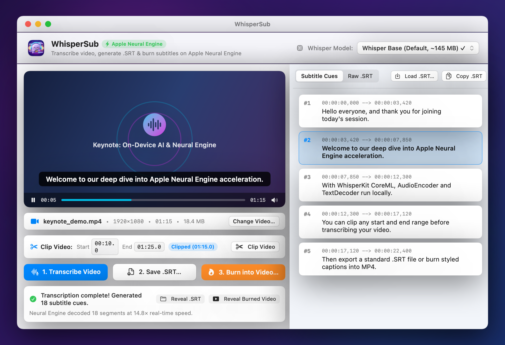
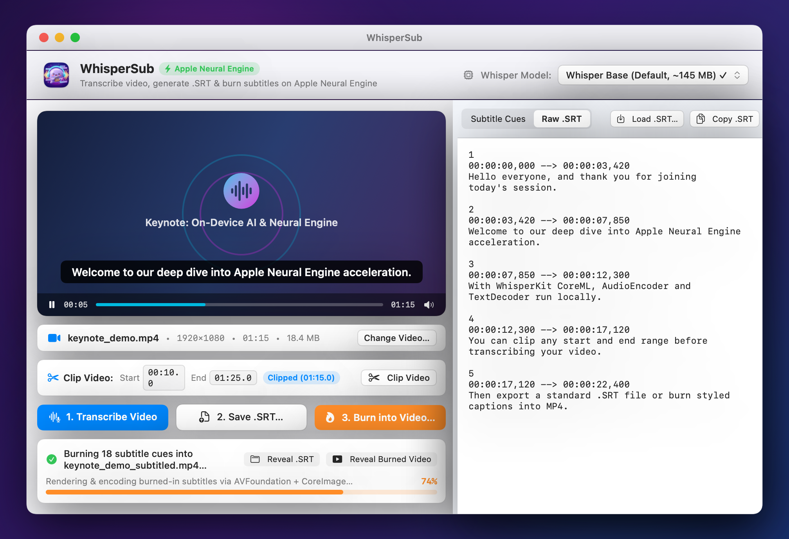

<p align="center">
  
</p>

<h1 align="center">🎬 WhisperSub — AI Video Subtitles on Apple Neural Engine</h1>

A native macOS app that transcribes videos using **OpenAI Whisper on the Apple Neural Engine** (via [WhisperKit](https://github.com/argmaxinc/WhisperKit) CoreML), generates `.srt` subtitle files, and burns `.srt` captions directly into the video.

## 📸 Screenshots

<p align="center">
  
</p>

<p align="center">
  
</p>

## Features

- **Apple Neural Engine Acceleration**: Runs Whisper `AudioEncoder` and `TextDecoder` CoreML models on `.cpuAndNeuralEngine` for fast, low-power local transcription.
- **In-App Model Selector**: Choose and download model sizes directly in the app (`Whisper Tiny`, `Whisper Base` default, `Whisper Small`, `Whisper Large v3 Turbo`). Models and tokenizers are cached locally in `~/Library/Application Support/WhisperSub`.
- **Simple Workflow**:
  1. **Drop Video** (`.mp4`, `.mov`, `.m4v`, `.avi`, `.webm`, `.mkv`) and preview with live synchronized captions.
  2. **Optional Video Clipping (Start / End Time)**: Specify a start and end time (or set from playhead) to clip the video before transcription so no time is wasted transcribing or burning unneeded sections.
  3. **Transcribe & Save `.SRT`**: Automatically formats timestamps (`HH:MM:SS,mmm --> HH:MM:SS,mmm`) and exports `.srt` files (or load an existing `.srt`).
  4. **Translate Subtitles (18+ Languages & Bilingual Mode)**: Translate subtitle cues into Chinese (Simplified/Traditional), English, Japanese, Korean, Spanish, French, German, and more with zero configuration, or use Whisper's native on-device speech-to-English (`Audio→EN`) task. Toggle seamlessly between **Translated Only**, **Bilingual (Original + Translated stacked)**, and **Original Only** for live preview, `.srt` export, and video burn-in.
  5. **Burn `.SRT` into Video**: Hardware-accelerated native `AVFoundation` + `CoreImage` compositor burns crisp, styled subtitles (single-language or two-line bilingual) directly into an `.mp4` video.
- **CLI Mode**: Also supports headless batch execution (including `--start`/`--end` clipping, `--translate`, `--bilingual`, and `--whisper-translate`):
  ```bash
  ./WhisperSub.app/Contents/MacOS/WhisperSub --cli input.mp4 --start 00:10 --end 00:45 --translate zh-CN --bilingual --srt output.srt --burn output_subtitled.mp4
  ```

## Building & Running

```bash
./build_app.sh
open WhisperSub.app
```
